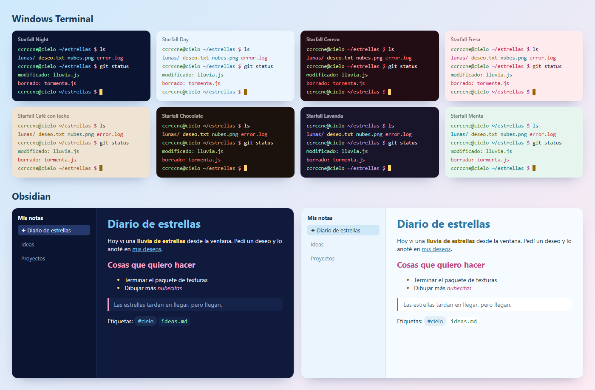

# Starfall Themes

Los colores de [Starfall para VS Code](https://github.com/ccrccne/starfall-vscode), ahora para **Windows Terminal** y **Obsidian**. Son 8 paletas: Night, Day, Cereza, Fresa, Café con leche, Chocolate, Lavanda y Menta.



## Windows Terminal
1. Abre Windows Terminal y ve a **Configuración** (`Ctrl + ,`).
2. Abajo a la izquierda pulsa **Abrir archivo JSON**.
3. Busca la parte que dice `"schemes": [` y pega dentro todo lo que hay en [`windows-terminal/starfall-schemes.json`](windows-terminal/starfall-schemes.json) (sin los corchetes `[` `]` del principio y del final). Si ya tienes otros esquemas, separa con una coma.
4. Guarda. En **Perfiles → Valores predeterminados → Apariencia → Combinación de colores** elige el Starfall que más te guste.

## Obsidian
El tema usa **Starfall Night** en modo oscuro y **Starfall Day** en modo claro.

1. En tu bóveda, abre la carpeta oculta `.obsidian/themes/` y crea una carpeta llamada `Starfall`.
2. Copia ahí `obsidian/theme.css` y `obsidian/manifest.json`.
3. En Obsidian: **Ajustes → Apariencia → Temas** y elige **Starfall**.

**Los otros colores:** copia el archivo que quieras de `obsidian/snippets/` a `.obsidian/snippets/` y actívalo en **Ajustes → Apariencia → Fragmentos CSS**. Cereza, Chocolate y Lavanda son para el modo oscuro; Fresa, Café con leche y Menta, para el modo claro.

## Cómo se hace
Los colores no se escriben a mano: `generar.js` los toma de los temas de VS Code, así todo combina. Para regenerarlos, con [starfall-vscode](https://github.com/ccrccne/starfall-vscode) en la carpeta de al lado:
```bash
node generar.js
```

## Licencia
[MIT](LICENSE). Hecho por **ccrccne** · [ccrccne.github.io](https://ccrccne.github.io)
